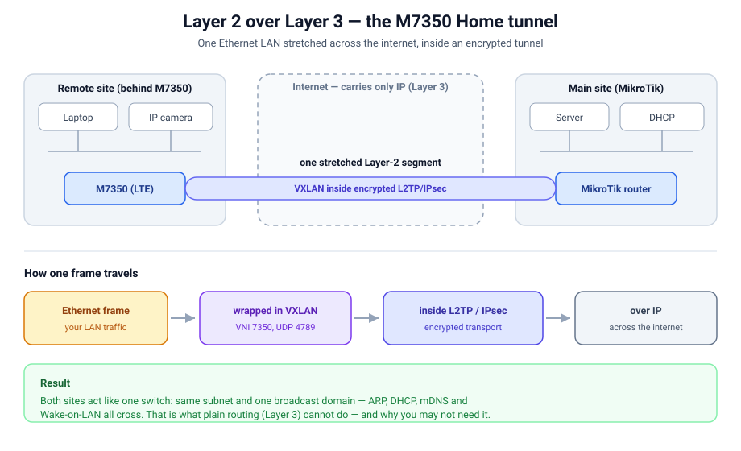

# M7350 Home mode: Layer-2 over Layer-3

Home mode does something a normal VPN does not. A normal VPN **routes** (Layer 3):
the two sides keep different subnets and IP packets are forwarded between them.
Home mode **bridges** (Layer 2): it stretches a single Ethernet segment across the
internet, so devices behind the M7350 behave as if plugged into the same switch as
the devices at the main site — same subnet, same broadcast domain.

The internet only moves IP (Layer 3), so the Ethernet frames are wrapped in
**VXLAN** and that VXLAN runs *inside* an encrypted **L2TP/IPsec** tunnel.



## Do you actually need Layer 2?

Most of the time, **no** — plain routed (Layer-3) access is simpler, faster and
safer. Bridge only when devices must truly share one broadcast domain.

**Use Layer 2 (Home mode) when:**

- devices discover each other only by broadcast/multicast and can't be pointed at
  a remote IP — some cameras/NVRs, legacy industrial gear, licensing dongles;
- a remote device must get its address from the **main site's DHCP** and sit in the
  same subnet as everything there;
- you need **Wake-on-LAN**, ARP, mDNS/Bonjour or SSDP discovery to cross the link.

**Stay with routed (Layer-3) VPN when:**

- you just need to reach services by IP or hostname — then route and skip this;
- throughput matters: L2 adds encapsulation overhead, drops the usable MTU to
  ~1310, and floods broadcast traffic across the WAN;
- you want the two sites isolated (a broadcast storm or loop at one site would
  otherwise cross to the other).

If none of the "use Layer 2" points apply to you, you don't need this guide.

## Turning it on — both ends

Both ends must agree on the same parameters. The M7350 side is fixed by the
firmware; set the MikroTik side to match.

| | Value |
|---|---|
| IKE | IKEv1, PSK, `aes128-sha1-modp2048`, NAT-T on (LTE is CGNAT) |
| ESP | `aes128-sha1-modp1024`, transport mode, UDP/1701 |
| L2TP / PPP | L2TP server, **CHAP** (the packaged `pppd` has no MS-CHAPv2) |
| Addresses | server (VTEP) `10.73.51.1`, M7350 `10.73.51.2` |
| Overlay | VXLAN VNI 7350, UDP 4789, MTU 1310 |

### M7350 (client)

In the web UI, open **VPN → Home**, point the profile at `<SERVER_PUBLIC_IP>`, set
the PSK and PPP password, enable **L2 bridging**, and activate. The device forces
UDP encapsulation and builds the VXLAN over PPP automatically. If a start fails it
shows the specific cause (bad PSK, rejected proposal, server unreachable, PPP auth
rejected) on the web UI and the OLED.

### MikroTik (server)

Verified on **RouterOS 7.24.5**. Fill in `<SERVER_PUBLIC_IP>` (client side only),
`<IPSEC_PSK>`, `<PPP_PASSWORD>`, `<L2_BRIDGE>`; the PSK and PPP password are
secrets — set them on the router, don't commit them. `m7350-home` and the
`10.73.51.0/30` addresses are examples. Keep the listener disabled until the
firewall rules are in. Test against an **isolated bridge** first.

```routeros
# IPsec (IKEv1/PSK, AES-128/SHA-1, NAT-T) + L2TP server, CHAP only
/ip ipsec profile
set [find where name="default"] enc-algorithm=aes-128 hash-algorithm=sha1 dh-group=modp2048 lifetime=1d nat-traversal=yes dpd-interval=2m dpd-maximum-failures=5 proposal-check=obey
/ip ipsec proposal
set [find where name="default"] enc-algorithms=aes-128-cbc auth-algorithms=sha1 pfs-group=modp1024 lifetime=30m
/ppp profile
add name=m7350-home local-address=10.73.51.1 remote-address=10.73.51.2 only-one=yes change-tcp-mss=yes use-ipv6=no use-encryption=no
/ppp secret
add name=m7350-home password="<PPP_PASSWORD>" service=l2tp profile=m7350-home
/interface l2tp-server
add name=l2tp-m7350-vx user=m7350-home
/interface l2tp-server server
set enabled=no use-ipsec=required ipsec-secret="<IPSEC_PSK>" authentication=chap max-mtu=1450 max-mru=1600 keepalive-timeout=30

# Firewall: open IKE/ESP on WAN, keep VXLAN inside the tunnel (list WAN must exist)
/ip firewall filter
add chain=input in-interface=l2tp-m7350-vx src-address=10.73.51.2 dst-address=10.73.51.1 protocol=udp dst-port=4789 action=accept comment="M7350 VXLAN in via PPP"
add chain=input protocol=udp dst-port=4789 dst-address=10.73.51.1 action=drop comment="M7350 VXLAN in guard"
add chain=input in-interface-list=WAN protocol=udp dst-port=4789 action=drop comment="No VXLAN on WAN"
add chain=input in-interface-list=WAN protocol=udp dst-port=500,4500 action=accept
add chain=input in-interface-list=WAN protocol=ipsec-esp action=accept
add chain=input in-interface-list=WAN protocol=udp dst-port=1701 ipsec-policy=in,ipsec action=accept
add chain=input in-interface-list=WAN protocol=udp dst-port=1701 action=drop
add chain=output out-interface=l2tp-m7350-vx src-address=10.73.51.1 dst-address=10.73.51.2 protocol=udp dst-port=4789 action=accept comment="M7350 VXLAN out via PPP"
add chain=output protocol=udp dst-port=4789 dst-address=10.73.51.2 action=drop comment="M7350 VXLAN out guard"

# L2 overlay: VTEP on the PPP peer address, blackhole the remote VTEP when PPP is down
/interface bridge
add name=lo-m7350-vx protocol-mode=none
/ip address
add address=10.73.51.1/32 interface=lo-m7350-vx
/ip route
add dst-address=10.73.51.2/32 routing-table=main blackhole distance=254
/interface vxlan
add name=vxlan-m7350 vni=7350 port=4789 local-address=10.73.51.1 mtu=1310 allow-fast-path=no
/interface vxlan vteps
add interface=vxlan-m7350 remote-ip=10.73.51.2
/interface bridge filter
add chain=forward in-interface=vxlan-m7350 mac-protocol=ip ip-protocol=udp src-port=67 action=drop
add chain=input in-interface=vxlan-m7350 mac-protocol=ip ip-protocol=udp src-port=67 action=drop
# Pin the LAN bridge MTU BEFORE adding the port: with mtu=auto RouterOS drops the
# whole bridge to the smallest port MTU (1310) and full-size LAN traffic breaks.
/interface bridge
set [find where name="<L2_BRIDGE>"] mtu=1500
/interface bridge port
add bridge=<L2_BRIDGE> interface=vxlan-m7350 edge=yes bpdu-guard=yes hw=no

# Enable the listener only after the rules above are in place
/interface l2tp-server server set enabled=yes
```

Things that trip people up:

- **Bridge MTU.** A bridge left at `mtu=auto` takes the lowest MTU of its ports.
  Adding the 1310-byte VXLAN port to your LAN bridge then lowers the MTU for the
  *whole LAN*, even while the M7350 is offline: TCP handshakes succeed, but
  full-size replies (e.g. TLS server certificates) are dropped and HTTPS hangs.
  Set the bridge MTU explicitly to 1500, as above. Better still, keep the
  overlay on a dedicated bridge or VLAN rather than your main LAN bridge.
  Frames larger than 1310 bytes still can't reach the M7350 side, so its
  clients rely on TCP MSS clamping.
- The ESP PFS group (MODP1024) deliberately differs from the IKE DH group
  (MODP2048) — that is the M7350 offer, keep it.
- The VXLAN VTEP is the PPP peer `10.73.51.1`, **not** the public IP; using the
  public address as VTEP fails the client's dedicated-peer check.
- On a shared router, editing the `default` IPsec profile/proposal affects other
  IPsec clients — create a non-default profile and bind it to this listener
  instead.

## Check it's up

- `/ppp active print` shows one session, remote `10.73.51.2`.
- `/ip ipsec active-peers print` shows an established IKE SA and **two mature ESP
  SAs**.
- A device at each site can ping the other on the **same subnet**, and DHCP from
  the main site reaches the remote one.
- Drop PPP and confirm **no UDP 4789 leaves on the WAN** (the blackhole takes
  over); reconnect and the overlay recovers.

Docs: [IPsec](https://help.mikrotik.com/docs/spaces/ROS/pages/11993097/IPsec) ·
[L2TP](https://help.mikrotik.com/docs/spaces/ROS/pages/2031631/L2TP) ·
[VXLAN](https://help.mikrotik.com/docs/spaces/ROS/pages/100007937/VXLAN)
